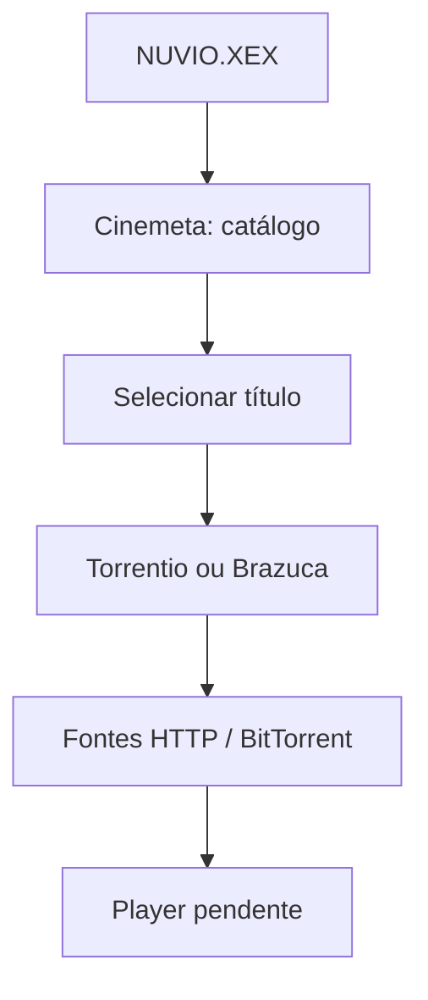

# 🧰 Desenvolvimento — para programadores

`NUVIO.XEX` é um executável PowerPC homebrew; o Xbox 360 RGH não roda um programa Windows comum.

O projeto depende de [xsdk](https://github.com/xenosworks/xsdk), [curl-xenon](https://github.com/xenosworks/curl-xenon), [mbedtls-xenon](https://github.com/xenosworks/mbedtls-xenon) e da biblioteca cJSON incluída em `third_party/cjson/`.

## Testar sem Xbox

Em Linux/WSL:

```bash
gcc -std=c17 -Wall -Wextra -Werror -Isrc -Ithird_party/cjson \
  tests/test_stremio.c src/stremio.c third_party/cjson/cJSON.c \
  -lm -o test_stremio
./test_stremio
```

## Compilar manualmente

O caminho mais simples para iniciantes é a aba **Actions** do repositório. Para compilar localmente:

1. Siga [xsdk Getting started](https://github.com/xenosworks/xsdk/blob/main/docs/GETTING_STARTED.md), instale a toolchain `powerpc-xsdk-elf` e compile `libxsdk.a`.
2. Clone os forks `curl-xenon` e `mbedtls-xenon` da branch `xenon`.
3. Configure com CMake:

```bash
cmake -S . -B build -GNinja \
  -DCMAKE_TOOLCHAIN_FILE=/caminho/xsdk/cmake/xsdk.cmake \
  -DXSDK_TOOLCHAIN=/caminho/xsdk-gcc \
  -DMBEDTLS_XENON_DIR=/caminho/mbedtls-xenon \
  -DCURL_XENON_DIR=/caminho/curl-xenon \
  -DCMAKE_BUILD_TYPE=Release
cmake --build build
```

O executável esperado é `build/NUVIO.xex`. Copie-o como `NUVIO.XEX` junto ao `cacert.pem` e arquivos `.txt`.

## Fluxo do aplicativo



O parser já reconhece hashes e links magnet; **não baixa torrents nem reproduz mídia**. A implementação do player é uma etapa separada.

### Segurança

- Mantenha a verificação de certificados HTTPS habilitada.
- Não comite tokens, senhas, API keys ou credenciais de serviços debrid num repositório público.
- Só use fontes de mídia licenciadas ou autorizadas.
