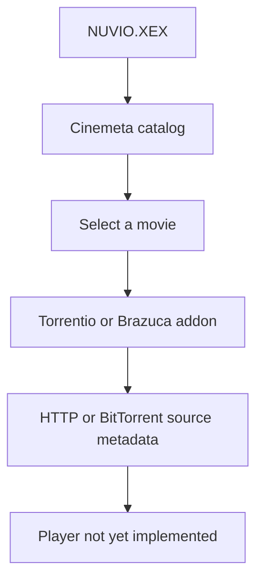

# 🛠️ Development and build guide

This guide is for maintainers. Users who only want to install the app should visit **[Releases](https://github.com/heltindev/NuvioXbox360/releases)** instead.

## Architecture

- **Native app:** C17 targeting Xbox 360 PowerPC through [xsdk](https://github.com/xenosworks/xsdk).
- **Networking:** [curl-xenon](https://github.com/xenosworks/curl-xenon) with [mbedtls-xenon](https://github.com/xenosworks/mbedtls-xenon) for certificate-checked HTTPS.
- **Protocol:** [Stremio addon protocol](https://github.com/Stremio/stremio-addon-sdk/blob/master/docs/protocol.md).
- **JSON:** bundled cJSON under `third_party/cjson` (MIT notice retained).



## Run tests without a console

On Linux or WSL:

```bash
gcc -std=c17 -Wall -Wextra -Werror -Isrc -Ithird_party/cjson \
  tests/test_stremio.c src/stremio.c third_party/cjson/cJSON.c \
  -lm -o test_stremio
./test_stremio
```

## Build the `.XEX` manually

The Xbox 360 requires a custom PowerPC compiler. Follow the official [xsdk getting started guide](https://github.com/xenosworks/xsdk/blob/main/docs/GETTING_STARTED.md) to install `powerpc-xsdk-elf` and build `libxsdk.a`. Then clone the `xenon` branches of `curl-xenon` and `mbedtls-xenon`.

```bash
cmake -S . -B build -GNinja \
  -DCMAKE_TOOLCHAIN_FILE=/path/to/xsdk/cmake/xsdk.cmake \
  -DXSDK_TOOLCHAIN=/path/to/xsdk-gcc \
  -DMBEDTLS_XENON_DIR=/path/to/mbedtls-xenon \
  -DCURL_XENON_DIR=/path/to/curl-xenon \
  -DCMAKE_BUILD_TYPE=Release
cmake --build build
```

Expected output after a successful build: `build/NUVIO.xex`. Copy it as `NUVIO.XEX` beside `cacert.pem`, `catalog_manifest.txt`, and `stream_addons.txt`.

## Maintainer workflow

1. Changes to C sources or the build workflow trigger the test/build action on `main`.
2. The custom PowerPC compiler and shader compiler are cached when built successfully.
3. Once a build succeeds, the downloadable test artifact appears on its Actions run.
4. To create a user-facing **prerelease**, manually run the workflow and enable the **Publish preview Release** input, providing a new version tag.
5. The release job only runs after compilation has passed; it attaches a ZIP, a checksum file, and clear preview notes.

**Visibility note:** In a public repository, workflow runs are not owner-private. Only maintainers can change the workflows and manually publish releases, but readers can inspect public CI information. To keep builds truly private, use a separate private build repository and publish its verified artifacts to this public repository.

## Security and responsible use

- Do not disable HTTPS certificate verification to bypass errors.
- Never commit personal debrid tokens, passwords, or API keys.
- Validate untrusted addon input and constrain resource sizes.
- Only fetch and stream media when authorized to do so.
- A successfully generated `.XEX` has **not** been verified on actual Xbox 360 hardware until tested there.
